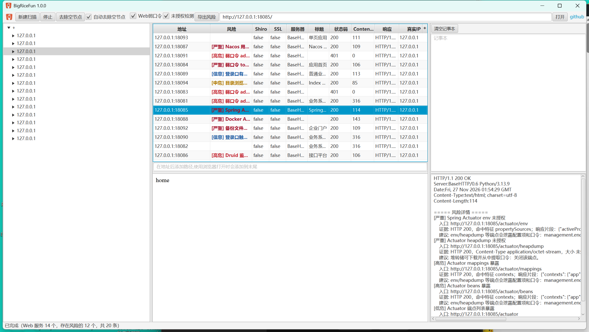

# BigRiceFun

内网 Web 资产测绘 + Web 风险检测。

离线运行，图形界面，不依赖 AI。



## 它做什么

给一段 IP 或网段，它会：

1. **扫端口、识别服务、抓网页标题**
2. **Web 弱口令**：自动找登录表单并试口令，支持表单登录、HTTP Basic、HTTP Digest（含无 `<form>` 的 JS 登录页）
3. **Web 未授权访问**：约 50 条特征，命中就给证据
4. **表格加一列「风险」**，按严重/高危/中危/低危/信息着色，点行看完整证据
5. **一键导出风险 CSV**（UTF-8 BOM，Excel 直接打开）
6. **状态栏进度条**：百分比、已完成/总数、Web 检测进度、已用时间和预计剩余，完成时机是真实的（扫描和检测全部结束才显示「已完成」）

只做 Web。SSH、数据库、Redis 这类协议层弱口令不碰。

## 快速开始

```
1. 装 Java 8（必须是 8，Java 11+ 不带 JavaFX）
2. 双击 build.bat（或 python -I tools/build.py）
3. 双击 dist\BigRiceFun.bat
4. 点「新建扫描」，填网段，点「开始扫描」
5. 看「风险」列，点行看证据，点「导出风险」存 CSV
```

### 建桌面快捷方式

不想每次进 `dist` 目录找 bat，双击一次 `dist\create-shortcut.bat` 就行，会在桌面生成
`BigRiceFun.lnk`，图标用的是自带的那张。

快捷方式指向 `dist\BigRiceFun.bat`，图标取自 `dist\BigRiceFun.ico`（也是同一套图标），
所以桌面图标和窗口标题栏是同一个。

删除快捷方式直接删桌面那个 `.lnk` 就行，不会动程序本体。

界面长这样：

```
┌─────────────────────────────────────────────────────────────────────────┐
│ [logo] 新建扫描 停止 去除空节点 ☑自动去除空节点 ☑Web弱口令 ☑未授权检测 导出风险 │
├──────────┬──────────────────────────────────────────┬───────────────────┤
│ 树        │ 地址 │ 风险 │ Shiro │ SSL │ 服务器 │ …   │ 运行日志           │
│ 主机→端口 │      │      │      │     │       │      │ 详情              │
├──────────┴──────────────────────────────────────────┴───────────────────┤
│ 已完成（Web 服务 14 个，存在风险的 12 个，共 20 条）                        │
└─────────────────────────────────────────────────────────────────────────┘
```

## 两个关键改进

### 1. 「完成」是真的

状态栏不扫描完就显示 complete，那时扫描任务还在跑，结果要等好几秒才陆续进表格。

现在只有**扫描任务和 Web 检测全部结束**才显示完成：

```
scanning...  →  (扫描中… 剩余 N)  →  (Web 检测中… 剩余 N)  →  收尾中…
             →  已完成（Web 服务 14 个，存在风险的 12 个，共 20 条）
```

已经显示完成后又来了新结果，会自动撤回重来。

### 2. Web 风险检测

**弱口令**（工具栏「Web弱口令」）

| 方式 | 做法 |
|---|---|
| 表单登录 | 首页 + 25 个常见登录路径找带密码框的表单；带验证码的只标记不爆破 |
| HTTP Basic | 根路径及 `/manager/html` `/admin` `/druid/index.html` `/api/overview` `/console` `/solr/` `/nacos/` 返回 401 时试对应默认口令 |
| HTTP Digest | 同上（摄像头、部分网络设备用这种） |

产品专属默认口令优先：Nacos、WebLogic、Jenkins、Druid、XXL-JOB、Zabbix、Grafana、Harbor、GitLab、
Nexus、phpMyAdmin、Kibana、Solr、若依、致远、泛微、用友、金蝶、通达、Tomcat、ActiveMQ、
海康/大华、打印机、网络设备。

通用字典默认只试 8 组，判成功靠和「随机账号」基线对比，出现锁定提示立即停手。

**未授权访问**（工具栏「未授权检测」）

Spring Actuator（env/heapdump/mappings/beans/jolokia/gateway）、Jolokia、Swagger/Knife4j、Druid、
Nacos、Jenkins、Tomcat Manager、JBoss、ActiveMQ、H2 控制台、Docker API、Kubelet、K8s API/Secrets、
Consul、etcd、Harbor、Hadoop Yarn/HDFS、Flink、Spark、Elasticsearch、Solr、RabbitMQ、Grafana、Kibana、
`.git` `.svn` `WEB-INF/web.xml` `.env`、phpinfo、pprof、metrics、Web 目录下的备份文件、目录浏览。

命中必须同时满足「返回 200 + 响应里有关键字」，避免把单页应用的兜底首页误报。

## 调字典

jar 同目录放 `BigRiceFun-dict.txt`（见 `dist\BigRiceFun-dict.example.txt`）：

```
# 每行 用户名:口令，会替换内置的 8 组通用口令
max=20
admin:Company@2024
test:Test@123
```

`max=N` 是通用字典最多试几组（默认 8）。产品专属默认口令不受这个额度限制。

改完重启生效。

## 目录结构

```
BigRiceFun/
├── src/main/java/com/bigricefun/   自己的代码
│   ├── Launch.java     jar 入口
│   ├── WebApp.java     挂图标、标题和检测
│   ├── Boot.java       风险列、开关、导出、状态栏完成判定
│   ├── WebAudit.java   单个 Web 服务的检测流程
│   ├── Rules.java      特征、登录路径、字典
│   ├── Form.java       登录表单解析（jsoup）
│   ├── Http.java       HTTP 客户端（用 jar 自带的 httpclient，支持 Basic/Digest）
│   └── RiskItem.java / RiskInfo.java
├── assets/              logo 与图标
├── tools/build.py       构建 + 打包 + 校验
├── test/TestDrive.java  测试驱动（不进 jar）
├── docs/                截图
└── dist/                构建产物（jar、启动脚本、图标、字典示例）
```

## 构建

```
python -I tools/build.py
```

需要 Python 3 和 JDK 8（不带第三方 Python 包）。脚本会：

1. 取基础 jar（本地缓存或已有 jar，带 SHA-256 校验）
2. 用 JDK 8 编译 `src/main/java`
3. 打包：2,733 个条目逐字节复制，只换 manifest 的 Main-Class，加上自己的类和图标
4. **校验：条目只要有一个变了就构建失败**
5. 组装 `dist/`：jar、启动脚本、桌面快捷方式脚本、图标、字典示例

## 已知限制

- **打不动的登录口**：验证码、短信二次验证、前端加密口令、AJAX 提交且没有 `<form>` 的页面。
  前两种标「信息」，后两种可能识别不到登录框
- **风险只存在内存里**，本次运行有效，不写进 H2 库；要留存请用「导出风险」。
  「导出为文本文件」也会把风险详情带在「响应」列里
- **每个 Web 服务约 100 个请求**（特征 + 登录路径 + 爆破），12 个线程并行
- **只按 IP 访问**：靠域名分发、必须带 Host 头的站点按 IP 访问可能拿不到真实页面
- **老旧 HTTPS 设备**（只支持 TLS 1.0）Java 8 默认握不上手
- 通用字典只有 8 组，命中主要靠产品默认口令和自己配的字典文件

## 授权与出处

只用于授权范围内的安全检查。
